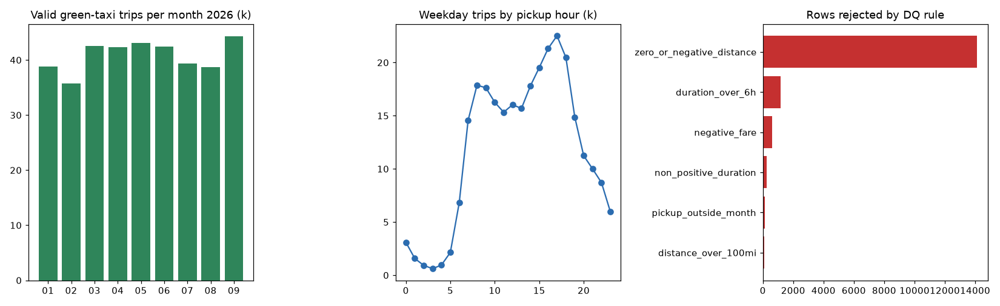

# NYC TLC batch pipeline: Airflow 3 + PySpark

A monthly batch pipeline over **383,790 real NYC green-taxi trip records** (2026-01 to 2026-09). It runs resumable ingest, then a PySpark transform with rule-based data-quality flags, then a reconciliation gate that fails the run if the numbers don't add up. It is orchestrated by an Airflow 3 TaskFlow DAG.

## Business problem
An operations or data team receives the TLC's monthly files and needs a repeatable job. The job should pick up the new month, absorb schema drift between files, quarantine bad records with a reason, and only publish curated data and aggregates once the row counts reconcile.

## Data
- **NYC Taxi & Limousine Commission, Trip Record Data (green taxi)**: monthly parquet files from the [TLC Trip Record Data page](https://www.nyc.gov/site/tlc/about/tlc-trip-record-data.page) (`d37ci6vzurychx.cloudfront.net/trip-data/green_tripdata_YYYY-MM.parquet`).
- **TLC Taxi Zone Lookup** (`taxi_zone_lookup.csv`): 265 zones mapped to boroughs.
- Raw files are not committed. `tlc/ingest.py` downloads them (resuming dropped connections with HTTP Range requests) and writes a SHA-256 manifest.

## Pipeline
```
target_month ──> download ──> spark_transform ──> quality_gate
 (logical-2mo)   (resumable,    (normalise schema,    (raw = valid + rejected,
                  sha256)        DQ flags, curated     curated = valid, aggs reconcile,
                                 parquet + 4 aggs)     reject rate <= 10%, else fail)
```
- **Airflow 3.1** (`dags/tlc_green_monthly.py`): TaskFlow API, `@monthly`, retries with delay, `max_active_runs=1`, and XCom hand-offs. Because the TLC publishes with a lag of about two months, a run for month M processes month M-2. **`airflow dags test` was run locally and all 4 tasks succeeded** (see `reports/airflow_dags_test.log`).
- **PySpark 3.5** (`tlc/spark_job.py`): casts each month to a single column contract, since the files drift in types and columns (for example `cbd_congestion_fee` is new in 2025). It applies 7 data-quality rules where the first match wins, uses broadcast joins to the zone and payment lookups, writes curated parquet partitioned by month, and builds aggregates by month×borough, zone, hour×weekend and payment type.
- **Quality gate** (`tlc/quality.py`): reads the Spark outputs back with DuckDB and raises an error, so Airflow marks the task failed, if any reconciliation check fails.
- `run.py` backfills Jan-Sep 2026 using the same functions, then generates the KPIs, chart and this README.



## Key findings (green taxi, 2026-01 to 2026-09)
- **367,409 valid trips** out of 383,790 raw rows. **16,381 (4.3%) were quarantined**, mostly for zero or negative distance (14,123) and trips longer than 6 hours (1,177).
- **$9,502,445** in total charges, averaging 3.397 mi and 17.36 min per trip.
- Green cabs serve the outer boroughs and upper Manhattan: Manhattan accounts for 59.1% of pickups (led by **East Harlem North** with 97,920 and East Harlem South with 47,279), followed by Queens at 22.5% and Brooklyn at 15.7%.
- The weekday peak pickup hour is **17:00**. The busiest month was 2026-09 (44,292) and the quietest was 2026-02 (35,790).
- The tip rate on credit cards is **20.8%**. Cash tips are not recorded, so the blended rate of 15.2% understates real tipping.

| DQ rule | rows rejected |
|---|---|
| `zero_or_negative_distance` | 14,123 |
| `duration_over_6h` | 1,177 |
| `negative_fare` | 617 |
| `non_positive_duration` | 260 |
| `pickup_outside_month` | 124 |
| `distance_over_100mi` | 80 |

## Skills shown
Apache Airflow 3 (TaskFlow, scheduling, retries, XCom, `dags test`) · PySpark (schema contracts, DataFrame API, broadcast joins, partitioned parquet, caching) · data-quality engineering and reconciliation · resumable HTTP ingest · DuckDB · pytest (Spark tests on synthetic fixtures, DAG integrity test) · GitHub Actions (separate Spark and Airflow jobs).

## How to run
```bash
pip install -r requirements.txt          # needs Java 17 for Spark
python run.py                            # download + Spark backfill + gate + KPIs + README
python -m pytest -q
# Airflow (separate env, official constraints):
pip install "apache-airflow==3.1.0" --constraint https://raw.githubusercontent.com/apache/airflow/constraints-3.1.0/constraints-3.12.txt
AIRFLOW__CORE__DAGS_FOLDER=$PWD/dags airflow dags test tlc_green_monthly 2026-11-01
```

## Honest caveats
- Spark runs in `local[*]` mode on a single machine, not on a cluster (no EMR/Databricks/Dataproc). The code is cluster-agnostic, but it has not been run at cluster scale.
- Airflow was run with `airflow dags test` (in-process), not as a deployed scheduler or worker.
- Green-taxi volume is modest (about 0.4M rows); yellow-taxi files were too slow to download on the build machine.
- This is an independent portfolio project using public data, not work for the TLC.

MIT licence · Amir Khan
